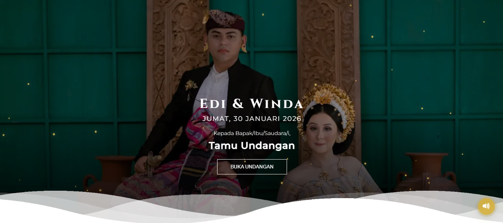
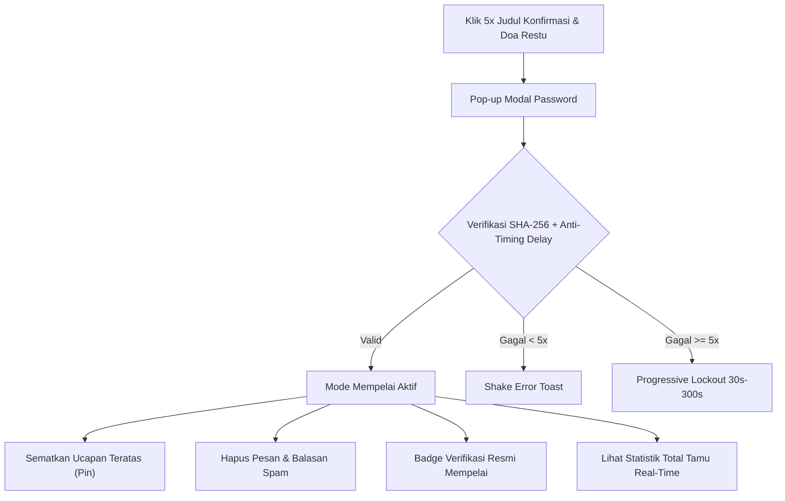

<div align="center">

# 💍 PAWIWAHAN THEME 1

### _Exclusive Digital Balinese Wedding Invitation Web Application_



<p align="center">
  <strong>Undangan Pernikahan Digital Adat Bali (Manusa Yadnya) Modern, Elegan, Interaktif, dan Terintegrasi Real-Time Cloud Firestore.</strong>
</p>

<p align="center">
  
  
  
  
  
  
</p>

</div>

## 📖 Tentang Proyek

**Pawiwahan Theme 1** adalah template undangan pernikahan digital bertema adat Bali yang dirancang dengan memadukan nilai kesakralan tradisi Hindu Bali (_Manusa Yadnya_) dan estetika web modern. Mengusung palet warna emas mewah (_Royal Gold_), tipografi _Cinzel Serif_, elemen gelombang dinamis, serta efek partikel gemerlap, platform ini memberikan impresi pertama yang hangat, megah, dan berkesan bagi para tamu undangan.

Dibangun dengan arsitektur **Vanilla Web Technologies** tanpa ketergantungan framework berat, situs ini menawarkan kecepatan muat maksimal (_high performance_), dukungan _Progressive Web App_ (PWA) untuk akses luring (_offline_), serta sistem interaksi buku tamu real-time tanpa reload berkat integrasi **Google Cloud Firestore**.

---

## ✨ Fitur Unggulan

<table>
  <tr>
    <td width="50%">
      <h3>💌 1. Interactive Cover & Music Ambience</h3>
      <ul>
        <li><strong>Personalized Guest Name:</strong> Deteksi nama tamu otomatis via URL parameter (<code>?to=Nama+Tamu</code>) dengan algoritma <em>auto font scaling</em> agar nama panjang tidak terpotong.</li>
        <li><strong>Dynamic Particle Effect:</strong> Animasi hujan partikel emas (<em>gold dust</em>) saat undangan dibuka.</li>
        <li><strong>Background Music & Media Session:</strong> Pemutaran musik latar otomatis dengan integrasi <em>Web Media Session API</em> (kontrol play/pause langsung dari status bar ponsel/lockscreen).</li>
        <li><strong>Floating Audio Controller:</strong> Tombol status musik mengambang dengan notifikasi HUD real-time.</li>
      </ul>
    </td>
    <td width="50%">
      <h3>🕊️ 2. Informasi Mempelai & Mantra Suci</h3>
      <ul>
        <li><strong>Profil Mempelai Pria & Wanita:</strong> Menampilkan foto resolusi tinggi, silsilah keluarga, dan alamat asal kedua mempelai.</li>
        <li><strong>Kutipan Sloka Suci Rg Veda:</strong> Mantra suci pernikahan (<em>Rg Veda X.85.42</em>) beraksara latin dan terjemahan bahasa Indonesia yang mendalam.</li>
        <li><strong>Animasi Halus:</strong> Transisi elemen scroll yang disesuaikan secara dinamis menggunakan library AOS.</li>
      </ul>
    </td>
  </tr>
  <tr>
    <td width="50%">
      <h3>📅 3. Rangkaian Acara & Countdown</h3>
      <ul>
        <li><strong>Detail Upacara & Resepsi:</strong> Jadwal lengkap jam pelaksanaan dan lokasi acara.</li>
        <li><strong>Sinkronisasi Server Countdown:</strong> Hitung mundur akurat yang disinkronkan dengan <em>Server Time Offset</em> (mencegah ketidaksesuaian akibat pengaturan jam lokal perangkat tamu).</li>
        <li><strong>Add to Calendar:</strong> Integrasi 1-klik simpan jadwal ke Google Calendar.</li>
        <li><strong>Google Maps Navigation:</strong> Tautan navigasi langsung ke titik lokasi acara via Google Maps.</li>
      </ul>
    </td>
    <td width="50%">
      <h3>📸 4. Advanced Photo Gallery & Lightbox</h3>
      <ul>
        <li><strong>Grid Masonry Responsif:</strong> Kombinasi tata letak foto portrait dan landscape yang dinamis.</li>
        <li><strong>Full-Featured Lightbox:</strong> Mendukung zoom digital hingga 4x, double-tap zoom, mouse panning, pinch-to-zoom (mobile), dan touch swipe (geser layar).</li>
        <li><strong>Fullscreen Mode & Download:</strong> Mode layar penuh dan tombol unduh foto langsung berformat asli.</li>
        <li><strong>Resilient Image Loading:</strong> Sistem <em>auto-retry</em> otomatis hingga 10x dengan bypass cache jika koneksi internet tamu sempat terputus.</li>
      </ul>
    </td>
  </tr>
  <tr>
    <td width="50%">
      <h3>💬 5. Real-Time RSVP & Interactive Guestbook</h3>
      <ul>
        <li><strong>Hybrid Form:</strong> Konfirmasi kehadiran (Hadir/Tidak Hadir), input jumlah tamu, dan ucapan doa restu.</li>
        <li><strong>Firebase Firestore Real-Time Feed:</strong> Ucapan baru langsung muncul secara instan tanpa perlu memuat ulang halaman (<em>zero refresh</em>).</li>
        <li><strong>Thread Balasan Bertingkat:</strong> Tamu dan mempelai dapat saling membalas ucapan dengan penanda <em>mention</em> otomatis.</li>
        <li><strong>Emoji Picker & Twemoji Universal:</strong> Keyboard emoji interaktif dan rendering vektor emoji seragam ala WhatsApp (<em>cross-platform consistency</em>).</li>
        <li><strong>Heart Floating Reactions (Likes):</strong> Efek animasi hamburan hati beterbangan saat tamu memberikan "Suka" pada pesan atau balasan.</li>
        <li><strong>Kursor Paginasi Firestore:</strong> Navigasi per 10 pesan yang hemat kuota dan efisien.</li>
      </ul>
    </td>
    <td width="50%">
      <h3>🎁 6. Digital Tanda Kasih & Hadiah Fisik</h3>
      <ul>
        <li><strong>Kartu Bank Digital:</strong> Tampilan kartu rekening mewah (BCA & Mandiri) dengan tombol <em>One-Click Copy</em> yang dilengkapi fallback untuk WebView/browser lama.</li>
        <li><strong>Pengiriman Kado Fisik:</strong> Alamat lengkap pengiriman kado fisik beserta nama penerima dan tautan peta lokasi.</li>
        <li><strong>Toast Notifications:</strong> Feedback visual modern saat nomor rekening berhasil disalin ke clipboard.</li>
      </ul>
    </td>
  </tr>
</table>

---

## 👑 Fitur Khusus: Mode Mempelai (Admin)

Website ini dilengkapi dengan **Mode Mempelai Tersembunyi** yang aman untuk memudahkan pemilik acara memoderasi ucapan dari para tamu tanpa perlu dashboard terpisah yang rumit:



### Keunggulan Mode Mempelai:

1. **Keamanan Kriptografi SHA-256:** Password diverifikasi menggunakan hashing satu arah (`Web Crypto API`), sehingga kata sandi asli tidak tersimpan dalam bentuk plain-text di kode sumber.
2. **Anti-Brute Force & Progressive Lockout:** Proteksi keamanan dengan _artificial delay_ 350ms (anti-timing attack) dan penangguhan akses bertingkat (30 detik hingga 5 menit jika gagal 5–10 kali).
3. **Sematkan Ucapan Favorit (_Pin Message_):** Tempatkan doa terindah dari keluarga atau tamu kehormatan di posisi paling atas dengan label khusus.
4. **Lencana Resmi (_Verified Badge_):** Balasan yang dikirim oleh mempelai otomatis mendapatkan centang biru verifikasi (_Verified Badge_).
5. **Moderasi Pesan (_Delete Action_):** Hapus ucapan atau balasan yang tidak sesuai dengan dialog konfirmasi khusus.
6. **Live Guest Counter:** Memantau akumulasi total jumlah tamu yang menyatakan hadir secara real-time langsung dari dokumen metadata/agregasi server.

---

## 🛠️ Tech Stack & Ekosistem

| Kategori                    | Teknologi                                       | Deskripsi                                                                                        |
| :-------------------------- | :---------------------------------------------- | :----------------------------------------------------------------------------------------------- |
| **Core Architecture**       | `HTML5`, `CSS3`, `JavaScript (ES6+)`            | Struktur semantik, styling fleksibel tanpa framework, dan JavaScript modern modular.             |
| **Database & Backend**      | `Google Firebase Cloud Firestore v10.7.1`       | Penyimpanan data kehadiran, doa restu, likes, replies, dan statistik secara real-time.           |
| **Emoji & Vector Graphics** | `Twemoji (@twemoji/api) & emoji-picker-element` | Rendering emoji seragam ala WhatsApp dan keyboard pemilih emoji interaktif.                      |
| **Typography**              | `Google Fonts (Cinzel & Montserrat)`            | Kombinasi font serif klasik bernuansa sakral dan sans-serif modern yang mudah dibaca.            |
| **Iconography**             | `Bootstrap Icons v1.11.3`                       | Ikon web berbasis font vektor yang tajam dan ringan.                                             |
| **Scroll Animation**        | `AOS (Animate On Scroll v2.3.4)`                | Efek animasi bertahap (_fade_, _zoom_) yang disesuaikan per breakpoint layar.                    |
| **PWA & Offline**           | `Service Worker (sw.js) & Web App Manifest`     | Caching cerdas (_Cache-First_ untuk media, _Network-First_ untuk script) dan instalasi aplikasi. |
| **Structured Data**         | `Schema.org JSON-LD`                            | Metadata SEO lengkap untuk hasil pencarian Google Rich Results (_Event_, _Place_, _Person_).     |

---

## 📁 Struktur Direktori & Aset

```bash
pawiwahan-theme-1/
│
├── 📁 assets/                           # Direktori aset statis & multimedia
│   ├── 📁 audio/                        # Musik latar instrumen pernikahan
│   │   └── wedding-music.mp3
│   ├── 📁 icons/                        # Favicon & icon web
│   │   └── favicon.ico
│   └── 📁 images/                       # Seluruh aset visual (WebP & PNG)
│       ├── 📁 couple/                   # Foto profil mempelai (groom & bride)
│       │   ├── groom.webp
│       │   └── bride.webp
│       ├── 📁 gallery/                  # Galeri foto momen bahagia & cover
│       │   ├── cover-1.webp
│       │   ├── cover-2.webp
│       │   └── gallery-01.webp ... gallery-12.webp
│       └── 📁 decorations/              # Ornamen visual & banner preview
│           ├── wave.webp
│           └── preview-banner.png
│
├── 🛠️ config.js                        # PUSAT KONFIGURASI UTAMA (Single Source of Truth seluruh konten)
├── 📄 index.html                        # Struktur utama halaman, meta SEO, & modal
├── 🎨 style.css                         # Desain sistem, palet warna, responsivitas, & animasi
├── ⚡ script.js                          # Logika interaktif, Firestore real-time, & lightbox
├── 📁 rules/                            # (Lokal) Konfigurasi keamanan & indeks Firestore (diabaikan .gitignore)
│   ├── 🔒 firestore.rules               # Aturan keamanan Cloud Firestore (Security Rules)
│   └── 📑 firestore.indexes.json        # Pengaturan Composite Indexes Firestore
├── 🔧 firebase.json                     # (Lokal) Konfigurasi deployment Firebase CLI (diabaikan .gitignore)
├── ⚙️ sw.js                             # Service Worker untuk manajemen cache & mode offline
├── 📱 site.webmanifest                  # Konfigurasi PWA (nama aplikasi, icon, tema warna)
├── 🗺️ sitemap.xml                       # Peta situs untuk pengindeksan mesin pencari (SEO)
├── 🤖 robots.txt                        # Pengaturan perayapan web crawler
├── 🙈 .gitignore                        # Konfigurasi pengabaian file Git ( OS, & IDE)
└── 📘 README.md                         # Dokumentasi lengkap proyek
```

---

## 💼 Lisensi Komersial & Pemesanan

_Source code_ template undangan digital ini merupakan karya orisinal yang dikembangkan dan didistribusikan secara komersial oleh **WinandaDev**.

- 🚫 **Dilarang Keras:** Mempublikasikan ulang, membagikan gratis, atau memperjualbelikan kembali _source code_ ini kepada pihak lain tanpa izin lisensi tertulis dari pemilik hak cipta.
- 📦 **Bagi Pembeli Source Code:** Anda berhak penuh menggunakan dan menyesuaikan template ini untuk proyek undangan pribadi maupun pesanan klien Anda.
- 📩 **Pemesanan Jasa & Pembelian Lisensi:** Silakan hubungi kontak resmi pengembang melalui [WhatsApp](https://wa.me/6285964393536).

---

## ⚙️ Panduan Kustomisasi & Konfigurasi

### 1. Manajemen Konten Terpusat (`config.js`)

Aplikasi ini menerapkan arsitektur _Single Source of Truth_. Seluruh konten acara — mulai dari identitas kedua mempelai, rangkaian upacara, integrasi Google Maps & Kalender, nomor rekening tanda kasih, hingga kredensial Firebase — dikonfigurasi secara terpusat melalui berkas **`config.js`**. (Adapun ayat suci mantra Rg Veda bersifat baku dan dikelola langsung secara statis pada `index.html`).

Mesin hidrasi data bawaan akan secara otomatis memetakan nilai-nilai konfigurasi tersebut ke seluruh antarmuka pengguna tanpa memerlukan modifikasi manual pada struktur markup `index.html`:

```javascript
window.WEDDING_CONFIG = {
    couple: {
        shortName: "Edi & Winda",
        dateDisplay: "Jumat, 30 Januari 2026",
        bgMusic: "assets/audio/wedding-music.mp3",
        coverImage1: "assets/images/gallery/cover-1.webp", // Sampul utama (portrait)
        coverImage2: "assets/images/gallery/cover-2.webp",
        mediaSessionCover: "assets/images/gallery/gallery-05.webp", // Artwork pemutar musik lockscreen HP (1:1)
        // ...
    },
    mempelai: {
        groom: { fullName: "I Putu Edi Pratama", ... },
        bride: { fullName: "Winda Aprilia Dewi", ... }
    },
    events: {
        countdownTarget: "2026-01-30T08:00:00+08:00",
        list: [ ... ] // Rangkaian acara, maps, & kalender otomatis
    },
    gifts: {
        bankAccounts: [ ... ], // Otomatis me-render kartu rekening & tombol salin
        physicalGift: { ... }
    }
};
```

### 2. Penyesuaian Metadata Pratinjau Sosial (Open Graph & SEO)

Meskipun antarmuka web dan thumbnail audio disinkronkan oleh `config.js`, perayap media sosial (_crawlers_) seperti WhatsApp, Facebook, dan Telegram membaca metadata HTML statis sebelum JavaScript dieksekusi. Oleh karena itu, sesuaikan tag berikut pada bagian `<head>` berkas `index.html` sebelum publikasi link:

```html
<title>Undangan Pawiwahan | Nama Pasangan</title>
<meta property="og:title" content="Undangan Pawiwahan | Nama Pasangan" />
<meta property="og:description" content="Deskripsi undangan pernikahan..." />
<meta property="og:image" content="assets/images/gallery/gallery-05.webp" />
<meta property="og:image:secure_url" content="assets/images/gallery/gallery-05.webp" />
```

### 3. Personalisasi Nama Tamu Dinamis (URL Parameter)

Sistem secara otomatis mendeteksi dan mempersonalisasi nama tamu pada sampul undangan melalui query parameter `?to=`. Algoritma _auto font scaling_ memastikan nama panjang tetap proporsional dan tidak terpotong:

```text
https://domain-anda.com/?to=Nama+Tamu+Undangan
Contoh:
https://domain-anda.com/?to=Bapak+I+Wayan+Sudira,+S.T.+%26+Keluarga
```

### 4. Konfigurasi Layanan Cloud Firestore

Untuk menghubungkan fitur buku tamu dan RSVP real-time ke proyek Firebase Anda sendiri, sesuaikan objek `firebase` di dalam berkas `config.js`:

```javascript
firebase: {
    apiKey: "YOUR_API_KEY",
    authDomain: "YOUR_PROJECT_ID.firebaseapp.com",
    projectId: "YOUR_PROJECT_ID",
    storageBucket: "YOUR_PROJECT_ID.firebasestorage.app",
    messagingSenderId: "YOUR_SENDER_ID",
    appId: "YOUR_APP_ID",
    measurementId: "YOUR_MEASUREMENT_ID"
}
```

### 5. Manajemen Kredensial & Otorisasi Mode Mempelai

Autentikasi Mode Mempelai dilindungi oleh sistem keamanan bertingkat (_Dual-Tier Salted Token_): `security.mempelaiHash` di `config.js` untuk verifikasi antarmuka klien, serta token kriptografi pada fungsi `getAdminSecretHash()` di Cloud Firestore Rules.

Untuk memperbarui kata sandi administratif:

1. Buka console browser (`F12`) pada halaman web dan jalankan fungsi generator berikut:
   ```javascript
   async function generateBothHashes(pass) {
     const hash1 = Array.from(
       new Uint8Array(
         await crypto.subtle.digest("SHA-256", new TextEncoder().encode(pass)),
       ),
     )
       .map((b) => b.toString(16).padStart(2, "0"))
       .join("");
     const hash2 = Array.from(
       new Uint8Array(
         await crypto.subtle.digest(
           "SHA-256",
           new TextEncoder().encode(pass + "@pawiwahan-secure-backend-key"),
         ),
       ),
     )
       .map((b) => b.toString(16).padStart(2, "0"))
       .join("");
     console.log("mempelaiHash (config.js):", hash1);
     console.log("getAdminSecretHash (Firestore Rules):", hash2);
   }
   generateBothHashes("KataSandiBaruAnda");
   ```
2. Tempelkan nilai `hash1` ke properti `security.mempelaiHash` di `config.js`, dan nilai `hash2` ke fungsi `getAdminSecretHash()` pada berkas `rules/firestore.rules` (atau di tab Rules Firebase Console).

---

## 🛡️ Aturan Keamanan Firestore (Security Rules)

Seluruh konfigurasi keamanan database terpusat dan dikelola secara modular pada file `rules/firestore.rules`. File dan folder konfigurasi ini disimpan secara lokal dan dilindungi oleh `.gitignore` agar tidak terekspos secara publik di repositori GitHub. Aturan ini dirancang dengan tingkat keamanan sangat ketat (_High-Level Security Lockdown_):

- **🛡️ Validasi Ketat Data Kehadiran & Anti-Spam:** Membatasi ukuran teks nama (1–50 karakter), pesan (1–500 karakter), integritas status (`Hadir` wajib 1–10 orang, `Tidak Hadir` wajib 0 orang), serta mengunci status pin awal.
- **🔐 Otorisasi Bertingkat (_Dual-Tier Salted Token_):** Menjamin fitur sematkan (_pin/unpin_), hapus ucapan, dan centang verifikasi balasan mempelai (_blue badge_) hanya dapat dieksekusi oleh mempelai yang memegang kata sandi sah.
- **⚡ Batasan Operasi Dinamis (Anti-Bot):** Operasi _like_ dan _reply count_ dibatasi hanya $\pm 1$ per request serta mencegah nilai negatif.
- **🚫 Global Wildcard Lockdown:** Mengunci seluruh koleksi lain di database selain yang diizinkan (`allow read, write: if false;`).

### 🚀 Cara Menerapkan Security Rules & Indexes:

#### Opsi 1: Menggunakan Firebase CLI (Direkomendasikan)

Jalankan perintah berikut di terminal root proyek untuk men-deploy _rules_ dan _indexes_ sekaligus:

```bash
# Deploy Rules & Indexes sekaligus
npx firebase deploy --only firestore

# Atau deploy secara terpisah
npx firebase deploy --only firestore:rules
npx firebase deploy --only firestore:indexes
```

#### Opsi 2: Menggunakan Firebase Console (Manual)

1. Buka file lokal `rules/firestore.rules` di editor Anda lalu salin seluruh kodenya.
2. Masuk ke [Firebase Console](https://console.firebase.google.com/) > Pilih Project Anda > **Firestore Database**.
3. Buka tab **Rules**, tempelkan kode yang telah disalin, lalu klik tombol **Publish**.

---

## 🎨 Palet Desain & Tipografi

```
Primary Gold     : #d4af37  ■■■■■■■ (Tombol, Aksen, Scrollbar, Ikon)
Secondary Gold   : #bfa100  ■■■■■■■ (Hover State, Gradien)
Deep Dark Navy   : #1a202c  ■■■■■■■ (Theme Color, Cover Background)
Dark Canvas      : #121316  ■■■■■■■ (PWA Theme, Backdrop)
Pure White       : #ffffff  ■■■■■■■ (Background Konten Utama, Kontras Bersih)
Slate Grey       : #718096  ■■■■■■■ (Teks Deskripsi & Subjudul)
```

- **Judul & Header:** `Cinzel` (_Google Fonts_) – Memberikan kesan megah, elegan, dan bernuansa kerajaan klasik.
- **Teks Tubuh & Form:** `Montserrat` (_Google Fonts_) – Bersih, modern, dan sangat nyaman dibaca pada perangkat mobile.

---

## 📱 Performa & Best Practices

- ⚡ **Google Web Vitals Optimized:** Menggunakan format gambar generasi terbaru `.webp` yang dikompresi maksimal.
- 🚀 **Preload & Asynchronous Assets:** Preload aset kritis LCP (`cover-1.webp`), non-blocking font loading (`media="print" onload="this.media='all'"`).
- 🛡️ **Anti-Inspect & Content Protection:** Mencegah klik kanan tak sengaja, drag gambar sembarangan, serta pintasan inspeksi elemen.
- 📶 **PWA Service Worker:** Mendukung caching cerdas agar undangan tetap dapat dibuka dengan lancar meskipun sinyal tamu kurang stabil.

---

<div align="center">
  <p><em>"Ihaiva stam ma vi yaustam, visvam ayur vyasnutam, kridantau putrair naptrbhih, modamanau sve grhe."</em><br>
  <strong>— Rg Veda X.85.42 —</strong></p>
  <p>© Pawiwahan Theme 1 by WinandaDev. All Rights Reserved.</p>
</div>
